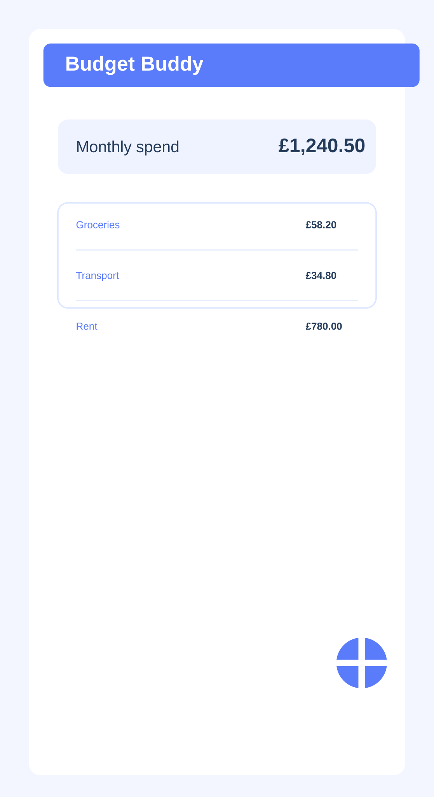
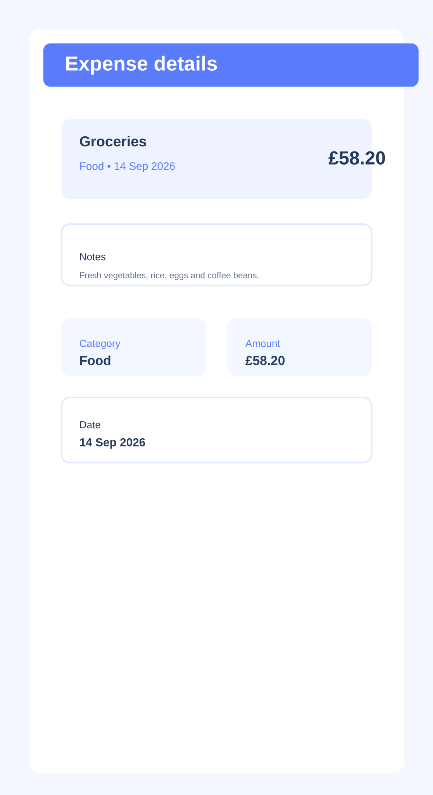
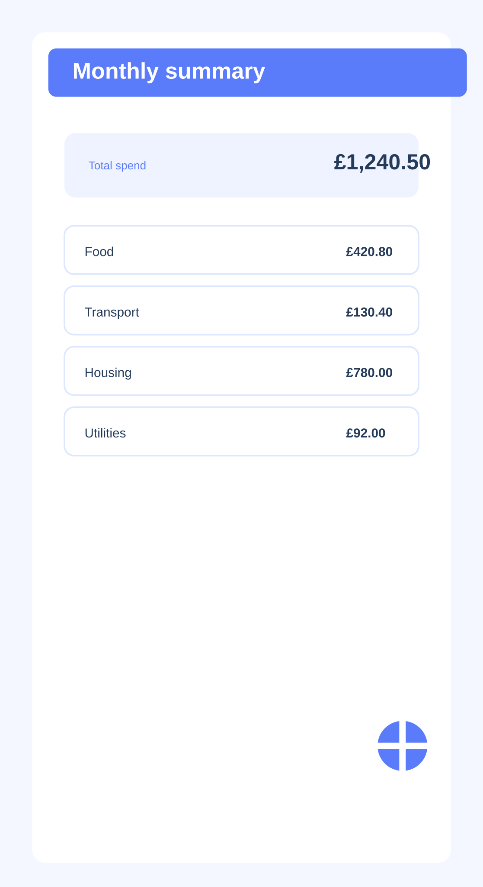

# Budget Buddy

Budget Buddy is a Flutter expense tracker built for the Android group project specification. The app helps users add, track, and review spending across categories while keeping records saved on the device.

## Application name and topic
- Name: Budget Buddy
- Topic: Expense tracker

## Short description
Budget Buddy lets a user add expenses with a validated form, review them in a detail view, and see spending totals by category in a summary screen. All data is stored locally using shared preferences so it is available after a restart.

## Data source used
The app stores records locally on the device using SharedPreferences.

## Screenshots




## Steps to run
1. Install Flutter 3.35 or newer.
2. Install Android Studio with the Flutter and Dart plugins.
3. Clone the repository.
4. Run `flutter pub get`.
5. Connect an Android device or emulator.
6. Run `flutter run`.

To build a release APK:

```bash
flutter build apk --release
```

## Team members and responsibilities
- Student A — app structure, Provider state, and summary screen
- Student B — form validation and local persistence
- Student C — detail screen, theme, docs, and testing

## Project structure
- `lib/models` — expense model
- `lib/services` — local storage service
- `lib/providers` — ChangeNotifier provider state
- `lib/screens` — list, detail, form, and summary screens
- `lib/widgets` — reusable UI widgets
- `test/` — widget tests
